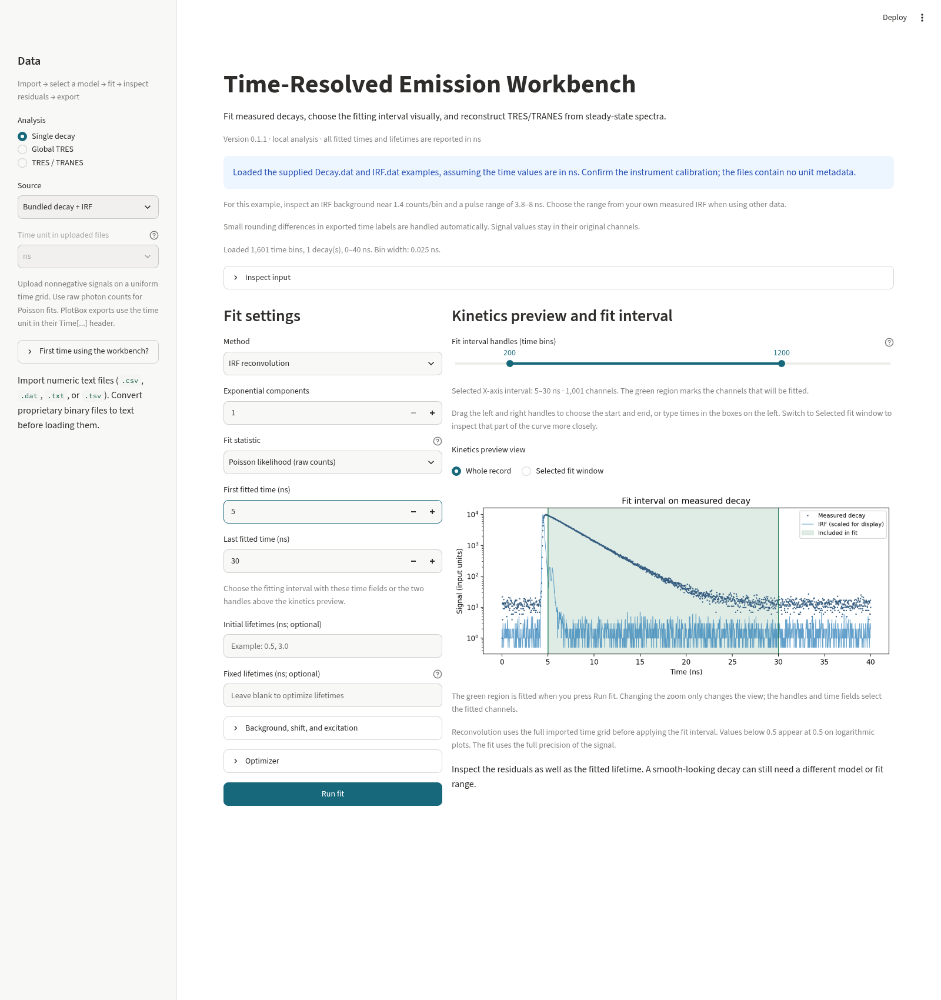

# Time-Resolved Emission Workbench

A local Python application for fitting single and wavelength-resolved emission decays, sharing lifetimes across traces, and reconstructing time-resolved emission spectra (TRES) and their area-normalized forms (TRANES).

**Version 0.1.1.** The project was formerly TCSPC Workbench. TCSPC is the main demonstrated workflow.



## What it does

- Fits single decays by measured-IRF reconvolution or exponential tail fitting.
- Fits multiple wavelength decays with shared lifetimes and separate nonnegative amplitudes/backgrounds.
- Provides linked fit-window handles, numerical time limits and kinetics previews.
- Reconstructs TRES/TRANES using the global-fit result and steady-state fluorescence intensities.
- Accepts normalized intensity files, full spectra with normalization/sampling, or manually entered intensities at the fitted wavelengths.
- Offers PCHIP, straight-line and B-spline display connections while preserving calculated spectral samples.
- Exports numerical results, settings, diagnostics, wavelength mappings and reconstruction provenance.

Calculations run locally; Streamlit displays the interface in your browser. Ordinary local analysis needs no cloud account. The application includes a Python API and command-line tools.

## Start here

**Experimental users:** read the illustrated [User guide](USER_GUIDE.md). Its offline edition, `USER_GUIDE.html`, opens directly in a browser after extracting the whole package.

**Already have a compatible Python environment?** You can use it. Open a terminal with that environment activated, change to this repository's folder containing `app.py`, then run:

```bash
python -m streamlit run app.py
```

Use the Local URL printed in the terminal, usually `http://localhost:8501`. Keep that terminal open; Ctrl+C stops the app.

**First installation:** use the [Windows quick start](QUICK_START_WINDOWS.md) or the complete [installation instructions](INSTALLATION.md). The Windows guide includes an Anaconda/MKL option. A standard virtual-environment route is:

```bash
python -m venv .venv
```

Activate it with `source .venv/bin/activate` on macOS/Linux or `.venv\Scripts\activate.bat` in Windows Command Prompt, then:

```bash
python -m pip install -r requirements.txt
python -m streamlit run app.py
```

Python 3.12 is the version used for local release validation; the declared minimum is 3.10. Dependency installation requires internet access. For Anaconda Navigator, PowerShell or an existing environment, follow [INSTALLATION.md](INSTALLATION.md) rather than mixing installation routes.

## Typical workflow

1. Load a decay and measured IRF, or a time-by-wavelength decay matrix.
2. Confirm units, component count, IRF preparation and the fitting interval.
3. Run the fit and inspect residuals, convergence and parameter stability.
4. For global spectral analysis, select **Continue to TRES / TRANES**. The wavelengths, amplitudes and lifetimes transfer automatically.
5. Supply steady-state intensities by file or manual table, choose reconstruction delays and download both the fit and reconstruction archives.

Use original photon counts for Poisson fitting. See the [data-format guide](DATA_FORMATS.md) for CSV layouts, units and source-curve selection. Use the ignored `data/` directory for your own measurements kept within the project folder.

## Scientific scope and current limitations

The same exponential models can fit compatible fluorescence upconversion and other pulsed photoluminescence decays, including simple phosphorescence decays. This requires evenly spaced samples, finite nonnegative observations, and kinetics that the model can represent. For nonnegative intensity data with roughly constant noise variance, choose unweighted least squares. For reconvolution, supply a measured instrument response appropriate to the acquisition. These compatibility conditions describe the model's applicability. The bundled demonstrations focus on TCSPC and spectral reconstruction.

- IRF and decay **bin widths must match** for reconvolution. Different acquisition windows can be supported; unequal bin widths are not automatically rebinned.
- The importer accepts tiny export rounding on a uniform time grid. Genuinely uneven scans and missing internal time channels are rejected.
- One time-unit selector applies to both plain-text decay and IRF uploads. Convert them to the same units before import.
- Tail-fit reconstruction needs the known elapsed delay between excitation and the first fitted channel.
- The model uses nonnegative exponential components; signed rise components, dedicated anisotropy models and kinetic target analysis are not implemented.
- TRES reconstruction needs corresponding steady-state intensities. The bundled 51-wavelength measured example does not include its matching steady-state spectrum.
- Reconstruction uncertainties are not propagated. Spline connections are for display and do not establish finer measured spectral resolution.

See [Scientific notes](SCIENTIFIC_NOTES.md) for definitions and assumptions. A converged optimizer or a diagnostic near one does not establish a physical model.

## Validation and development

The numerical, import and CLI suite contains **69 tests**. The earlier v0.1.0 release validation also exercised manual table entry and the single and global interfaces in Streamlit and Chromium. See [VALIDATION.md](VALIDATION.md) for test scope.

Run the numerical suite from the repository root:

```bash
python -m unittest discover -s tests -v
```

GitHub Actions is configured to run the suite on Linux and Windows with Python 3.10 and 3.12. Hosted results appear in the repository's **Actions** tab.

[Contributing](CONTRIBUTING.md) explains development and numerical-change expectations. [Support](SUPPORT.md) describes useful bug reports. Keep private measurements, credentials and local environments out of commits; `.gitignore` covers designated data/output folders, not arbitrary files everywhere on the computer.

## Repository contents

| Path | Purpose |
|---|---|
| `app.py`, `tcspc/` | Application, numerical engine, importers and CLI |
| `tests/` | Numerical, import, export and CLI tests |
| `examples/` | Synthetic and contributed examples, with provenance |
| `example_results/` | Reference outputs reproducible with example scripts |
| `docs/` and root guides | Screenshots, scientific review and offline documentation |
| `.github/` | CI workflow and issue/pull-request templates |

## Licence, data and citation

Original project code/documentation use the [MIT licence](LICENSE). Contributed measured examples retain their original rights; the code licence does not grant rights to those measurements. Read [Example-data provenance](examples/README.md) before redistributing the full example collection publicly.

Use [CITATION.cff](CITATION.cff) to cite the software version and its author. A tagged release can also be archived through a service such as Zenodo.

**Updating the GitHub repository?** Follow [GITHUB_UPLOAD.md](GITHUB_UPLOAD.md) to apply the complete v0.1.1 package to the existing repository and create a release.
